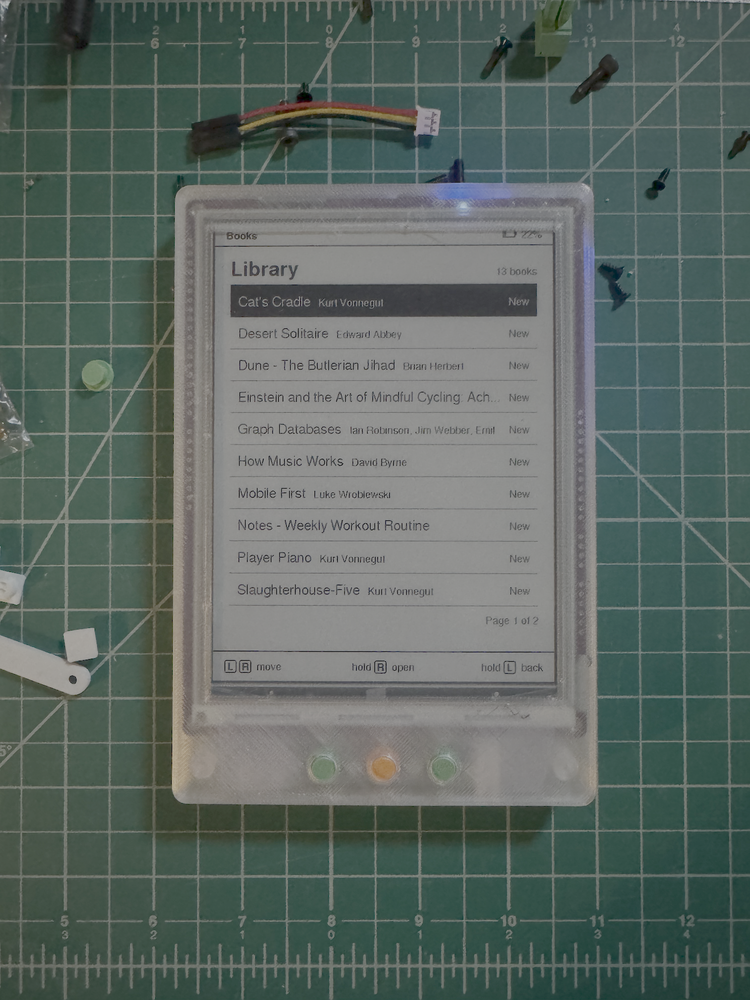

*An open-source, Kindle-sized ESP32 build with a book on one side and an MP3 player on the other.*

I wanted one device that does two things well: read books on e-ink for weeks between charges, and play my own music files over Bluetooth or a headphone jack, with no phone, subscription or app. I couldn't find one, so I'm building it. It's called **Duet**, and it's open source under GPL-3.0.

**Repo:** [github.com/mmassie/duet-media-player](https://github.com/mmassie/duet-media-player)

## What it is

Duet is a Kindle-sized, 3D-printed folio. It has a 6-inch e-ink screen, three physical buttons, a battery, and a microSD card for books and music. A switch on the side powers the music side on and off.

- **Reader:** Soldered Inkplate 6 (800×600 e-ink, ESP32).
- **Music:** Adafruit HUZZAH32 Feather, with a UDA1334A DAC for the 3.5 mm jack and Bluetooth A2DP for wireless headphones.
- **Storage:** Adafruit microSD breakout for the music library.
- **Case:** a parametric OpenSCAD design. The boards sit face-down on M2.5 heat-set insert standoffs, so no tape or glue holds anything in.

## Why two boards?

The Inkplate has an ESP32, so it seems like it could play music too. It can't do it comfortably:

1. **Bluetooth audio needs the original ESP32.** A2DP isn't available on the newer ESP32 variants. The HUZZAH32 is a classic ESP32, so it handles audio.
2. **Decoding MP3 and refreshing e-ink compete for time.** A full-screen e-ink refresh takes the better part of a second. Audio buffers don't wait for that.

Splitting the work means the music keeps playing while you turn pages, and each board runs a simple loop. They talk over I²C through a Qwiic cable, using a small checksummed protocol that's identical in both sketches (`duet_link.h`).

## The interface

I wanted both halves to feel like one product, so Books and Music share a single visual language. 

- **Home:** Books, Music, Settings.
- **Library:** the same row-based list as the music browser.
- **Music browser:** Albums, then tracks. It shows one album or the whole card, with shuffle and a now-playing screen.
- **Bluetooth pairing:** it scans, ranks candidates by signal strength and prefers nearby devices. It widens the search after 45 seconds, and restarts the scan if a connection hangs for more than 25 seconds.
- **Sleep screen:** the Duet logo in 3-bit greyscale, with no frame around it.

Books come from EPUB files. The reader unzips them on the device, inflates the chapters, walks the OPF spine, and caches clean text, so page turns after the first open are fast.

## What works, and what doesn't yet

I want to be honest here, because this is a build log and not a product page.

**Checked so far:**

- Both sketches have been run through host-side simulators that render the e-ink screens and exercise the EPUB pipeline and the audio logic.
- I checked the Bluetooth and I²C code paths against the library sources.

**Not yet done:**

- Neither sketch has been compiled with the real ESP32 toolchain. I expect a few rounds of fixes once I do.
- The firmware hasn't run on hardware.
- The printed parts, including the tongue-and-groove joint and the icon keys, are untested.
- There's one real electrical risk. An unpowered Feather (music switch off) may drag the shared I²C lines down and stop the Inkplate from turning pages. The README describes a bench test. The fixes are a BSS138 level shifter, or keeping the Feather powered and putting it to sleep instead.
- Mono and 48 kHz MP3s play at the wrong speed over Bluetooth for now. Stereo 44.1 kHz is fine.

## Build it, break it, send fixes

Everything is in the repo: firmware for both boards, the OpenSCAD source with exported STLs, the Duet wiring diagram, the design mockups, and a README with the bill of materials and print notes. If you build one, the most useful things you can send me are:

- I²C bench results with the music board unpowered.
- Which Bluetooth headphones pair reliably and which don't.
- Print results for the tongue-and-groove joint and the key icons.

I'll post a follow-up once the first prototype is assembled and running.

*Duet is GPL-3.0. Issues and pull requests are welcome.*